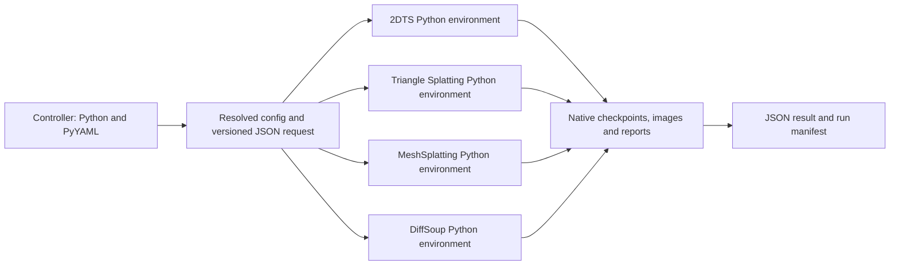

# Long-term benchmark maintenance

This change preserves 2DTS, Triangle Splatting, MeshSplatting, DiffSoup, all existing
experiment configs, native entry points, Unity deployment, video/viewer, geometry,
and connectivity functionality. Runtime isolation uses Python executable paths
managed by the user. It does not provision environments or change metric protocols.

## Audit and completed changes

| Finding in the previous implementation | Change / current boundary |
| --- | --- |
| Method names, aliases, Python paths and operators were repeated across registries and Unity export | `msbench/methods.py` declares the four built-ins; render/backend/training discovery and Unity aliases consume it |
| Renderer and training plugin discovery repeated code and swallowed all import errors | Shared discovery records failures, isolates unrelated plugins, and includes failures in lookup errors |
| Default installation auto-compiled every CUDA backend when a toolkit was detected | Python-only default; explicit method/operator selection; typo validation; automatic KNN dependencies |
| Build isolation required torch even for controller-only metadata/install | Base build needs setuptools/wheel; runtime dependencies are extras; explicit CUDA builds use the chosen environment's torch |
| Multiple environments could reuse a common build tree and editable binaries | Build tree keyed by interpreter/backend/torch/CUDA/architecture; isolated workers require non-editable installs and run with `-I` |
| Old `renderers/importing.py` helpers and `BackendSpec.sys_paths()` had no callers and only implemented obsolete path-injection/no-op behavior | Removed; retained the still-used `repo_root` compatibility constructor/status fields |
| 2DTS package import probed Gaussian/Hybrid operators during ordinary TS use | Experimental branches are preserved and loaded only on explicit attribute access; data-loader `RawGaussian` remains |
| Shell wrappers repeated method alias handling with inconsistent aliases | Shared shell helper; existing script arguments retained |
| CUDA availability diagnostics could report an existing Python wrapper as an installed operator | Probe actual native `_C`/`_core` modules and expose load errors |
| KNN fallback used quadratic `torch.cdist` allocation and referenced an unimported `torch` | Missing extension now raises before fallback; training preflight checks the selected rasterizer and KNN |
| MeshSplatting could discover missing `rdel` late in a run | Check when restricted Delaunay is enabled; retain and record the existing optional fused-SSIM choice |
| ccache wiring set `CUDAHOSTCXX` to a caching wrapper instead of a host compiler | Use PyTorch `PYTORCH_NVCC` and CMake CUDA compiler launcher |
| Runtime/viewer assets were not explicitly included in package data | Package palettes and viewer assets; exclude checkout binaries from package data/source manifests |
| Video encoding cropped a 1-pixel dimension to zero | Pad dimensions below 2 before the existing even-dimension crop |
| README referenced an absent topology wrapper | Use the existing `single_unity_eval.sh` options for each topology condition |

The vendored methods contain similar camera, COLMAP, SH, loss, and mesh utilities.
These are **not automatically interchangeable**: camera conventions, resizing,
alpha/background composition, optimizer state, topology, checkpoint formats,
and losses can affect results. Their wholesale deduplication needs numerical
equivalence evidence per method. Upstream algorithm code and licenses remain in
place. The current four CUDA operators do not become a single universal renderer.

## Architecture now available



The controller never unpickles checkpoints or imports method CUDA code. Each stage
starts a worker with that environment's Python. The request identifies protocol
version, run, stage, method, resolved config and output path. The worker runs the
existing CLI and returns artifact records plus Python/package/torch/CUDA/GPU
metadata. Config SHA-256, installed package RECORD hash, worker hash, workspace
Git revision/dirty state, stage exit status and logs are retained. The workspace
revision identifies experiment/config provenance; the package RECORD hash identifies
the installed worker distribution, which may be built from a different revision.

The runner executes exactly the explicitly requested stages, in order. It stops
on failure and marks the run failed/interrupted. It checks required output paths,
nonempty checkpoints, current JSON reports, render frame counts and referenced
image paths. It preserves native checkpoint formats and existing output locations.
It does not claim that process success alone establishes valid benchmark results.

| Stage | Required artifact |
| --- | --- |
| train | `train_stats.json` and a nonempty `ckpt/` |
| render | Config-resolved `renders/{split}/manifest.json` and referenced images |
| eval | Config-resolved metrics JSON |
| profile | Config-resolved profile JSON |
| inspect | Config-resolved statistics JSON |

Native training resume/skip behavior remains in the method. A resumed stage can
reuse checkpoints but must produce a current stage report. Output images and
checkpoints remain mutable in their established directories; per-invocation
manifests are separate, but this is not yet an immutable result store. Do not run
two jobs against the same `output.dir` concurrently.

## Adding another method

Two integration paths are supported:

1. **Independent plugin package (preferred for a new method).** Install its own
   Python dependencies and native operators in its environment, and install a
   non-editable msbench wheel there. Provide a renderer adapter and register it
   through a module entry point in `msbench.adapters`. For generic training,
   provide a module entry point in `msbench.training_methods` whose import calls
   `register_training_method`. Define its configs and add its Python path to the
   runtime YAML. The controller accepts matching trainer/adapter identifiers
   beyond the four built-ins; it does not need the plugin installed in the control
   environment. Its training implementation owns CUDA preflight and must produce
   the artifact contract above. Build its operators in its own package, rather
   than adding every new operator to the core install.
2. **Another bundled method.** Add a `MethodSpec`, build/operator mapping, adapter,
   training implementation, entry points and configs. The existing builtin build
   helper still defines how each operator is compiled. This path shares releases
   with the core and should be reserved for methods maintained here.

Entry points are intentionally module-based: loading the module executes the
registration decorator. Pointing to a bare class without registration is not a
supported contract in the current discovery implementation. Existing renderer
and training entry-point groups remain available. The MeshSplatting training
entry point is now declared as well. 2DTS uses its native config training bridge;
it is not falsely advertised as a generic `TrainingMethod` implementation.

The current generic `TrainingLoop` is optional. A native optimizer/topology update
schedule should not be translated to generic hooks solely for API uniformity.
For a method requiring a wholly independent training CLI, introduce a versioned
method runner hook before integration; do not add another `if method == ...`
branch to the shared CLI. That hook is part of the next refactor, not an existing
interface implemented by this change.

## Proposed next phases

### 1. Define and version the measurement protocol

Before changing scoring, decide and freeze dataset release/checksums, train/test
frame IDs, downscaling/rounding, camera convention, alpha/background/mask policy,
SSIM implementation, LPIPS network and tiling, aggregation weights, random seeds,
profiling resolution/warmup/synchronization/repeats, GPU sample coverage, and
Unity exporter/renderer versions. Existing per-method settings are preserved in
this change. In particular `test.py` is a separate DiffSoup-oriented image scorer
with resizing and tiled LPIPS; it must not silently replace the standard evaluator.

Then introduce an evaluator environment consuming saved predictions/GT and
camera/split manifests. Quality scoring should use the same implementation and
dependency lock for all methods. Native render/profile stays in the method
environment. The current `eval` may re-render through an adapter and therefore
still runs in the method environment, as explicitly selected for this phase.
Recording versions improves traceability but does not establish identical metric
implementations across environments.

### 2. Introduce a method runner and capabilities contract

Move native dispatch/argv construction out of `cli/train.py` into method-owned
runners. Declare capabilities (train, render, image eval, geometry, native profile,
Unity export, Unity method-aware/general-purpose, video) and fail unsupported
operations explicitly. Four method/dataset combinations do not have identical
capabilities: Unity camera replay currently needs COLMAP sparse binaries, and
general-purpose appearance export can be rejected by its existing contract.

Keep `RendererAdapter` as the in-process runtime API, with explicit camera/RGB
layout/device rules. Add contract tests for checkpoints, scene loading and stage
artifacts rather than assuming a method with a registry entry supports all commands.

### 3. Separate package ownership and environment locks

Move the bundled methods and CUDA build recipes into independently released
plugins once runner/measurement contracts are stable. The present pure controller
wheel still carries vendored source code; it avoids imports/builds but is not yet
a physically minimal source distribution. A plugin should pin its upstream
revision, Python/PyTorch/torchvision/toolkit/compiler dependencies, GPU architectures,
operator ABI and optional acceleration choices. Supply environment locks or container
recipes verified against an actual GPU for each method; do not invent those pins
from this repository's broad `>=` constraints.

PyTorch documents that CUDA extensions need an installed CUDA toolkit and that
architecture selection affects generated binaries. Its extension build interface
supports environment-level build control; this does not solve runtime version
conflicts between methods. See [PyTorch C++/CUDA extensions](https://docs.pytorch.org/docs/stable/cpp_extension.html).
Python entry points provide package-owned discovery, as specified by
[PyPA](https://packaging.python.org/en/latest/specifications/entry-points/).
Pip's build isolation concerns the temporary **build** environment, not separate
runtime environments: [pip build-system documentation](https://pip.pypa.io/en/stable/reference/build-system/).

### 4. Replace duplicated orchestration gradually

Consolidate target expansion, scene lists, path resolution, retries, summaries and
stage selection into a Python batch runner. Keep `single_*.sh` as compatibility
wrappers. This change only centralizes shell method aliases; the large shell
pipelines still contain repeated dataset/config/report handling. Avoid rewriting
all workflows simultaneously with a scoring protocol change.

### 5. Establish independent release checks

Use CPU CI for config inheritance, registry failures, controller import isolation,
worker protocol, artifact validation and package contents. Add separate GPU jobs
for each method's wheel build, missing-dependency failures, tiny training/render
round trips and comparison with frozen reference outputs. Use tolerances for
native numerical behavior rather than asserting bitwise equality across CUDA
versions. Keep Unity checks separate and verify renderer/export contract revisions.

Publish a benchmark protocol version separately from package version. Aggregate
only runs sharing the required protocol, dataset/split and measurement conditions;
mark missing/failed cases explicitly. A future immutable result store should keep
checkpoint/image hashes and config/environment locks for each run without
overwriting prior results. Scheduling, automatic provisioning and cloud services
are outside this change.

## Validation boundary

The cleanup is validated with repository CPU/regression tests, subprocess contract
tests, an actual non-editable controller/worker wheel smoke test, and real CUDA
forward/backward checks. CUDA build selection is tested without recompiling the
operators. Full native GPU training,
operator compilation across all environments, and Unity Player rendering still
need separate runs on the intended environments; no new performance or image
quality result is claimed here.

Validation in this checkout: the CPU suite completed with **457 passed, 7 skipped**;
an installed non-editable worker completed an `inspect` stage and generated a
matching result/artifact manifest. The controller wheel has only PyYAML as a base
dependency and contains no `.so` files; viewer assets are present. All benchmark
YAML configs, shell syntax/help entry points, changed infrastructure lint and
whitespace checks were verified.

GPU validation in the existing `msbench` environment used physical **GPU 4**, an
RTX 4090, with PyTorch **2.7.1+cu118**. The final complete suite passed with
**467 passed, 2 skipped** in 24.06 seconds:

```bash
CUDA_VISIBLE_DEVICES=4 /home/zkx/anaconda3/envs/msbench/bin/python \
  -m pytest msbench/tests -q -rs
```

All four methods passed CUDA preflight. New tests in
`msbench/tests/test_cuda_rasterizers.py` execute real 32x32 forward/backward
rasterization for 2DTS, Triangle Splatting, MeshSplatting and DiffSoup, requiring
nonempty finite renders and nonzero finite gradients. DiffSoup checks feature,
vertex edge and opacity auxiliary gradients. The KNN operator is compared with
the three-neighbor squared-distance reference. These five tests all passed.
The Triangle Splatting adapter tests now probe the actual bundled native module;
three previously mis-skipped checkpoint/statistics/primitive tests also passed.
The remaining two skips reference an already-removed legacy Unity export script.
The one warning is a third-party gstaichi/Pydantic deprecation.

No CUDA OOM occurred on GPU 4. This validates the existing compiled operators and
small differentiable renders; it does not establish full-training convergence,
cross-environment rebuild compatibility, large-scene performance, or Unity Player
rendering results.

## Prepared COLMAP images and loader profiling

Stored-image COLMAP factors `2/4/8` resolve to `images_2/4/8` with effective factor `1`.
Configuration overrides apply before this resolution, so changing only
`dataset.resolution` still selects the correct pyramid level. Resolution rules
live in the runtime-independent `msbench/core/image_sources.py`; controller
configuration inspection does not need mounted datasets. Training records the
effective dataset configuration in `dataset_source.json`. Native 2DTS, native
and generic Triangle/MeshSplatting, DiffSoup, and the shared evaluation loader
all use prepared images under their declared protocol. Missing prepared folders/files fail; evaluation never
substitutes a full-resolution original for a missing prepared image.

DTU, synthetic datasets, explicit custom folders and target-width/automatic
resolution controls keep their existing preprocessing. Different COLMAP image
sizes use the stored dimensions to scale calibration. For bicycle, the old
2DTS dynamic input was 1236x821; the stored `images_4` input is 1237x822 and also
has different preprocessing pixels. Runs across this change must be marked as
different input protocols, rather than compared as identical training inputs.
The already-running bicycle job was left intact.

Quality diagnosis subsequently found a protocol regression: on the same bicycle
checkpoint, restoring historical bilinear/floor inputs yields 26.252dB, while
the supplied `images_4` yields 25.149dB. The earlier historical result was
26.277dB. Room similarly changes from 32.165dB to 31.644dB. Adapter/native forward
comparisons on sampled cameras differ by less than 0.00003dB, so the image
protocol explains substantial evaluation loss without a renderer regression.

`legacy_bilinear_floor` reproduces those historical inputs, but it stays opt-in:
the 2DTS defaults use the stored `images_N` that every other method reads, so all
methods are scored on identical pixels (the shared dataset protocol). The offline
preparer `python -m tools.prepare_2dts_images --config path/to/scene-configs`
(scene configs that select the protocol) decodes original images once, applies native bilinear/floor preprocessing, writes
lossless PNGs, verifies them against the resized pixels, and publishes a cache
manifest atomically. Caches under `.cache/msbench/images` are ignored by Git;
`MSBENCH_IMAGE_CACHE_DIR` overrides the shared cache location. Dataset identity
separates scenes and source roots. Names retain the original complete filename
and append `.png`, avoiding extension/stem collisions. Cached reads have effective
factor 1, and both native 2DTS and evaluation use the same images/calibration.
Missing, incomplete or source-stale caches fail before use. Source images and
existing `images_X` are never overwritten; other methods' image protocols and
DTU/synthetic behavior remain unchanged.

Regression tests compare cached float tensors bit-for-bit against the original
native dynamic loader at factors 2, 4 and 8, including odd dimensions and nested
image names. They also check calibration, missing/stale/incomplete manifests,
idempotent preparation, and no runtime resizing. Local performance reports under
`profile_output/` are retained for inspection but ignored by Git.

Worker lifetime remains unchanged by the user's choice after A/B testing.
`profile_output/profile_2dts_loading.py` is standalone instrumentation: it uses
the native dataset and compares recreated versus persistent workers separately
for original/dynamic and prepared images. All policies within one source receive
identical image order and sampled pixel hashes, with 10 workers, prefetch factor
10, pinned CPU tensors, no RAM image cache, and balanced trial order. Its 70ms
consumer delay is synthetic, and its results describe data delivery rather than
full GPU training throughput. No instrumentation was inserted into live training.

The completed A/B and the user's decision are recorded in
`profile_output/REPORT.md`: production worker lifetime stays unchanged; tracing
long waits is a separate next round. Single-image preprocessing medians were
404.7ms for original/dynamic input and 19.8ms for prepared input. Epoch delivery
was highly variable, including hundred-second waits, so no stable full-training
speedup is claimed. The original GPU-7 run completed all 30,000 steps in 3140.5s.

Final validation including prepared-image regression tests completed in the
`msbench` environment on GPU 4: **481 passed, 2 skipped**, with the same single
third-party deprecation warning. The rebuilt Python-only wheel includes the
shared image-source module and contains no CUDA binaries.

Final protocol-repair validation: **490 passed, 2 skipped** in the existing
`msbench` environment on GPU 4; the single warning remains a third-party
deprecation. A separate two-step native 2DTS GPU training smoke test read the
lossless cache with effective factor 1 and completed successfully in `/tmp`.
All nine MipNeRF360 caches were generated (1,940 images, approximately 3.9GB),
and every manifest/source metadata entry was validated. Per the user's explicit
request, only the nine old `outputs/2dts/mipnerf360` scene results were deleted.
No full-scene retraining or new benchmark-quality claim is included.
